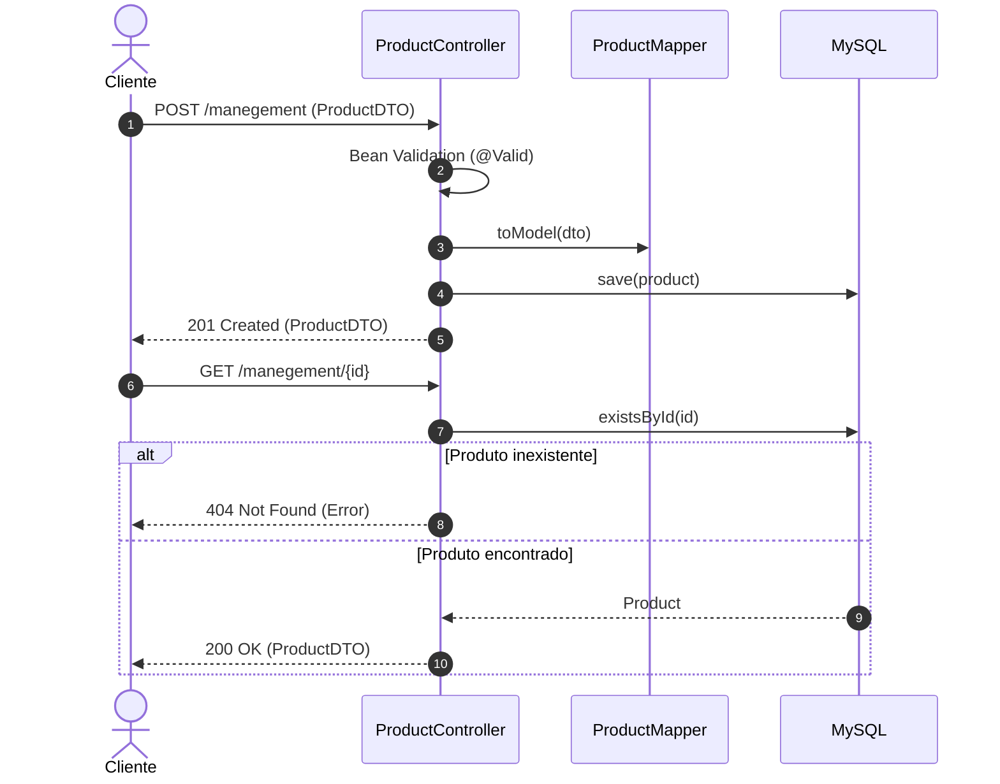

# 📦 Management API — Gestão de Estoque


> Cadastro, consulta, atualização e remoção de produtos em estoque, com documentação interativa via Swagger.

A **Management API** é uma API RESTful de gestão de estoque desenvolvida em **Java 17** e **Spring Boot 3**. Ela controla o nome, o preço e a quantidade em estoque de cada produto, valida os dados de entrada e expõe sua documentação OpenAPI pelo Swagger UI. Foi o meu primeiro projeto com Spring, construído a partir dos cursos da Alura.



---

## ✨ O Problema
Pequenos negócios costumam controlar estoque em planilhas:
- **Sem validação**: Preços negativos ou estoque inválido passam despercebidos.
- **Sem integração**: Outros sistemas não conseguem consultar ou atualizar os dados.
- **Sem documentação**: Quem consome os dados não sabe o formato esperado.

---

## 🚀 A Solução
- **CRUD completo de produtos** via REST.
- **Validação**: Nome obrigatório, preço positivo e estoque maior ou igual a zero.
- **Documentação interativa**: Swagger UI gerado automaticamente pelo SpringDoc.
- **Erros padronizados**: Produto inexistente retorna `404` com `message`, `status` e `timestamp`.

---

## 🎯 Diferenciais
- **Spring Boot 3 + Jakarta EE**: Base moderna do ecossistema Spring.
- **MapStruct**: Conversão entre entidade e DTO gerada em tempo de compilação.
- **Health check simples**: `GET /ping` responde `Pong`.

---

## 🛠️ Stack Tecnológica

| Camada | Tecnologia |
|---|---|
| **Linguagem** | Java 17 |
| **Framework** | Spring Boot 3.1.0 (Web, Data JPA, Validation, DevTools) |
| **Banco de Dados** | MySQL |
| **Documentação** | SpringDoc OpenAPI 2.1.0 (Swagger UI) |
| **Mapeamento Objeto-Objeto** | MapStruct 1.5.3 |
| **Boilerplate Reduction** | Project Lombok |
| **Build** | Maven (wrapper incluso) |

---

## 🏛️ Arquitetura

```
controller   ← Endpoints REST (ProductController, PingController)
   ↓
mapper       ← Conversão Product ↔ ProductDTO (MapStruct)
   ↓
repository   ← Interface Spring Data JPA
   ↓
model        ← Entidade JPA Product
```

### Entidade Principal
- **`Product`**: `id`, `name`, `price` (`BigDecimal`) e `stock` (quantidade em estoque).

---

## 📁 Estrutura do Projeto

```text
management-api/
├── pom.xml
├── mvnw / mvnw.cmd
└── src/main/
    ├── java/br/com/manegement/api/
    │   ├── controller/          # Endpoints REST
    │   ├── dto/                 # ProductDTO com validações
    │   ├── exception/           # Exceção de produto não encontrado e handler global
    │   ├── mapper/              # Mapper MapStruct
    │   ├── model/               # Entidade JPA
    │   └── repository/          # Repositório Spring Data
    └── resources/
        └── application.properties
```

---

## ⚡ Quick Start

### Pré-requisitos
- [JDK 17](https://adoptium.net/) instalado
- MySQL em execução na porta `3306`

### 1. Clonar o repositório
```bash
git clone https://github.com/matheusnascimentods/management-api.git
cd management-api
```

### 2. Criar o banco de dados
```sql
CREATE DATABASE stock;
```
A tabela é criada automaticamente pelo Hibernate (`ddl-auto=update`).

### 3. Executar a Aplicação
```bash
./mvnw spring-boot:run
```

A API estará disponível em: **`http://localhost:8080`**

A documentação interativa OpenAPI/Swagger fica disponível em:

- **`http://localhost:8080/swagger-ui/index.html`**
- **`http://localhost:8080/v3/api-docs`**

---

## 💻 Comandos Úteis de Desenvolvimento

```bash
# Compilar o projeto e processar anotações (Lombok + MapStruct)
./mvnw clean compile

# Rodar os testes
./mvnw test

# Empacotar o JAR e executá-lo
./mvnw clean package
java -jar target/api-0.0.1-SNAPSHOT.jar
```

---

## 🔌 API Reference

### 🛒 Produtos (`/manegement`)
| Método | Rota | Descrição |
| :--- | :--- | :--- |
| `GET` | `/manegement` | Lista todos os produtos |
| `GET` | `/manegement/{id}` | Busca um produto pelo id |
| `POST` | `/manegement` | Cadastra um produto |
| `PUT` | `/manegement/{id}` | Atualiza nome, preço e estoque |
| `DELETE` | `/manegement/{id}` | Remove um produto |

Corpo de `POST` e `PUT`:
```json
{
  "name": "Teclado Mecânico",
  "price": 299.90,
  "stock": 15
}
```

### 🩺 Health check (`/ping`)
| Método | Rota | Descrição |
| :--- | :--- | :--- |
| `GET` | `/ping` | Responde `Pong` (status `418 I'm a teapot`) |

### ⚠️ Respostas de erro
```json
{
  "message": "Não existe nenhum produto com id 10",
  "status": 404,
  "timestamp": "10-11-2026 10:30:00"
}
```

---

## 🗂️ Configuração

As configurações ficam em [`application.properties`](src/main/resources/application.properties):

| Propriedade | Descrição | Valor Default (Local) |
| :--- | :--- | :--- |
| `spring.datasource.url` | URL JDBC do MySQL | `jdbc:mysql://localhost:3306/stock` |
| `spring.datasource.username` | Usuário do banco | `root` |
| `spring.datasource.password` | Senha do banco | `root` |
| `spring.jpa.hibernate.ddl-auto` | Estratégia de criação do schema | `update` |

Pelo relaxed binding do Spring Boot, qualquer propriedade pode ser sobrescrita por variável de ambiente (ex.: `SPRING_DATASOURCE_PASSWORD`).

---

## 🔒 Segurança & Boas Práticas

- **Validação de entrada**: O cadastro passa por Bean Validation antes de ser persistido.
- **Sem autenticação**: A API não possui autenticação; é um projeto de estudo e não deve ser exposta publicamente sem uma camada de segurança.
- **Credenciais locais**: Os valores `root`/`root` servem apenas para desenvolvimento; use variáveis de ambiente em qualquer outro ambiente.

---

## 🤝 Contribuindo

1. Faça um Fork do projeto
2. Crie uma branch para a sua funcionalidade (`git checkout -b feature/nome-da-feature`)
3. Faça o commit das suas alterações (`git commit -m 'feat: implementa nova funcionalidade'`)
4. Envie para o repositório remoto (`git push origin feature/nome-da-feature`)
5. Abra um **Pull Request** detalhando as alterações

---

## 📄 Licença

Distribuído sob a licença MIT. Veja [`LICENSE.txt`](LICENSE.txt) para mais detalhes.

---
Feito com ❤️ por [@matheusnascimentods](https://github.com/matheusnascimentods)
